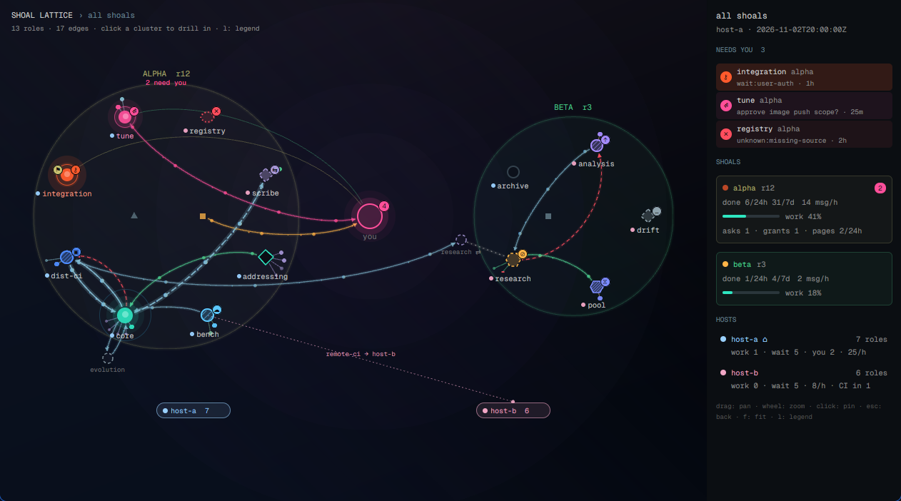

# shoal for the Herdr app

Mods for the Herdr app (the GPUI desktop window over herdr-core), as opposed to
`plugins/shoal-herdr/`, which targets the herdr 0.9.x terminal multiplexer. Nothing here changes
how shoal runs; every mod is read-only over shoal's own feeds.

| Mod | What it is |
|---|---|
| `mods/shoal-lattice` | The shoal graph doc v1 (`shoal ui graph --json`) as an animated, hoverable network: a global view of every shoal around the operator hub, a per-shoal view with host regions, a metrics and needs-you rail, and a compact `pulse` mode for an edge drawer. See its `RECIPE.md`. |



## Install

The mod reads the graph doc by running a program (`exec`) or reading a file, both optionally on
another machine through herdr-core (`on`). It reaches no network itself and writes nothing.

1. Copy or link the mod folder into the Herdr app home (`~/.config/herdr-app`, or
   `$HERDR_APP_HOME`):

   ```sh
   ln -s "$PWD/plugins/shoal-herdr-app/mods/shoal-lattice" ~/.config/herdr-app/mods/shoal-lattice
   herdr-app check ~/.config/herdr-app/mods/shoal-lattice
   ```

   `mod.json` says `"place": "none"`, so nothing docks by itself.

2. **Lattice tab.** Open it as a pane, ideally alone in a dedicated tab (labels need the room):

   ```sh
   herdr-app do tab.new '{"name":"lattice","mod":"shoal-lattice","props":{"source":{"kind":"exec","argv":["shoal","ui","graph","--json"],"on":null}}}'
   # or beside the focused terminal:
   herdr-app do pane.split '{"direction":"right","mod":"shoal-lattice","props":{"source":{"kind":"exec","argv":["shoal","ui","graph","--json"],"on":null}}}'
   ```

   `on` names a machine from `hc machine ls` when shoal runs there (`"on": "<machine>"`); `null`
   runs it here. Without herdr-core on that machine, use an ssh argv instead:
   `"argv": ["ssh", "<host>", "shoal", "ui", "graph", "--json"]`.

3. **Pulse drawer.** In a cloned layout (`herdr-app do layout.clone '{"name":"main","as":"my-main"}'`),
   add a floating block to the root node of `layouts/my-main.json`:

   ```json
   "floating": [
     { "id": "shoal-pulse", "edge": "right", "align": "end", "peek": 44,
       "content": { "mod": "shoal-lattice",
                    "props": { "mode": "pulse", "source": { "kind": "exec", "argv": ["shoal", "ui", "graph", "--json"], "on": null } } } }
   ]
   ```

   Each row is one shoal: its most urgent state dot (pulsing while something needs you), the
   needs-you count, messages per hour and a sparkline. Clicking a row asks the Lattice tab (if
   open) to drill into that shoal with the loudest role's card pinned.

4. Run `herdr-app check` after every edit, and `herdr-app status` for `errors`.

### Props

| Prop | Default | Meaning |
|---|---|---|
| `source` | `{"kind":"fixture"}` | `{"kind":"exec","argv":[...],"on":<machine or null>}` (after the first read the mod appends `--since <cursor>`), `{"kind":"file","path":"...","on":...}`, or `{"kind":"fixture","path"?:...}` (the bundled `fixtures/graph-v1.json`, with synthetic events every tick for a demo) |
| `mode` | `"full"` | `"pulse"`: one compact row per shoal |
| `view` | `"global"` | a shoal id to open drilled in |
| `pin` | none | a node id whose card opens pinned |
| `motion` | `"full"` | `"low"` caps the marching dots, `"off"` stops all motion |
| `items` | `true` | `false` hides the item satellites (also `i`) |
| `legend` | `false` | open with the legend shown (also `l`) |
| `poll_ms` | `4000` | data poll interval, 1500 to 60000 |

### Keys and pointer (Lattice tab)

Drag to pan (4 px threshold), wheel to zoom at the pointer, hover a node to fade everything not
connected to it and show its card, click to pin the card (links open in the browser; click the
`$ shoal view ...` line to copy it), click a cluster to drill in. `escape` unpins, closes the
legend, then goes back to the global view; `l` legend, `f` fit, `i` items, `+`/`-` zoom, arrows
pan. With `"focusable": true`, `pane.go` reaches the pane.

## Development

The mod's logic is in pure ES modules that run under Node (`model.js`, `layout.js`, `geom.js`,
`scene.js`); `main.js` only fetches, translates the display list into GPUI elements and handles
input.

```sh
node tests/herdr_app/test_lattice.mjs                       # unit tests on the fixture
node plugins/shoal-herdr-app/preview/render_svg.mjs --legend --out /tmp/lattice.svg
```

`preview/render_svg.mjs` draws the same display list to SVG for hosts that cannot run the Herdr
app. `preview.png` is a screenshot of the real app (`herdr-app shot`) on the fixture.
