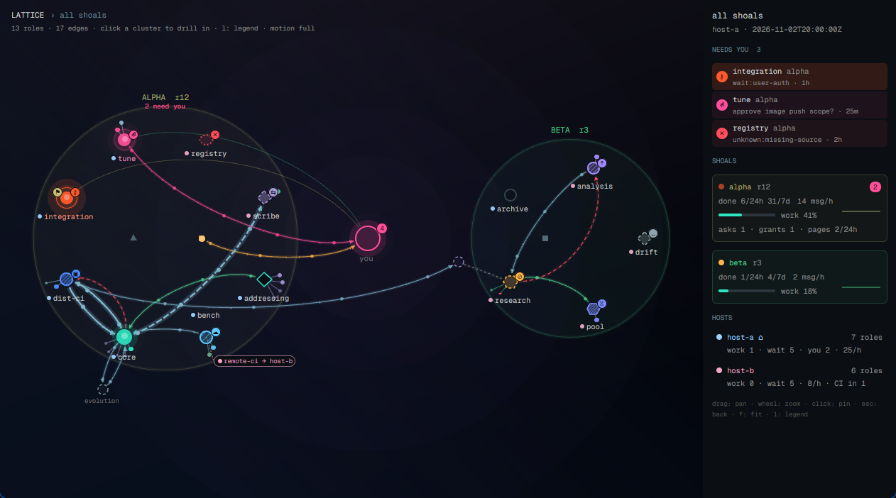

# Lattice view

A dark, glowing network of every shoal (a group of coding-agent roles coordinating through a git
ledger): each shoal a cluster of role nodes around the operator ("you") hub, edges for messages,
asks, offers, grants and blockers with dots marching along the busy ones, and every role that
waits on you pulsing loud enough to see from across the room. A rail on the right lists who needs
you, per-shoal throughput and per-host load.

## What you see

- **Canvas** (left, fills the pane): a near-black violet to navy gradient (`#14111a` to
  `#03050b`, 165 degrees) with a cool navy wash and a soft bloom behind the hub. Header top left in
  Geist Mono 11px: `LATTICE > all shoals`, counts below in `#8c8c8c` 9.5px.
- **Global view:** shoals on a ring around the `you` hub (22px ring, magenta `#ff4f9a` with a count
  badge when asks or grants are open). Each shoal is a translucent disc in a pastel tint (olive
  `#b0b070`, mint `#50d090`, teal `#70b090`, ...), its name above, `N need you` in
  magenta. Roles sit on a ring inside; hovering the middle of the disc shows the shoal's status. External writers (dashed circles) sit
  outside, an aliased one beside its home role with no label of its own (the alias tether says
  it). Hosts show as the dot before each label and in the rail; a role whose CI job runs on
  another host gets a small chip (`remote-ci -> host-b`) in that host's color.
- **Per-shoal view:** the shoal's roles on one ring split into host sectors: translucent annular
  bands in the host color, labeled with the host name (`⌂` marks the shoal's home). The hub in the
  middle, the shoal's status on a hover anywhere in the hole of the ring, externals outside.
- **Nodes:** circles (the agent's type is in the hover card), size by work done
  in 24 h, a host-colored dot before each label, a state badge top right, an olive `⚑` grant badge
  top left. State encodings:

  | state | look |
  |---|---|
  | working | teal `#2ee6c0` body, slow breathing halo |
  | user-auth | hot orange-red `#ff5a2c`, fastest pulse and ring, `⚷` badge |
  | user-ask / user-prompt | magenta, fast ring, `?` / `⏎` |
  | user-design | magenta, `✎` |
  | assignment / sources | softer magenta `#d985b6`, slow halo, `∅` / `↧` |
  | local-ci | blue `#4e8cff`, hatched at 4px, spinner arc, `▣` |
  | remote-ci | sky `#5cc8ff`, hatched at 7px, spinner arc, `☁` |
  | lease | periwinkle `#7c8cff`, dense hatch, `⧖` |
  | upstream | violet `#a58bff`, hatched, `↑` |
  | session-blocked (peer) | amber `#ffb547` dashed outline, `⊘`, a red dashed `blocked-on` edge to the blocker |
  | self | teal outline, no fill |
  | handover / refill / hold | lavender `⇆` / mint `↺` / grey `∥` |
  | any other wait event | grey dashed, `…`, raw event in the card |
  | idle | dim slate; excluded: hollow ring at 42 percent |
  | unknown or dead | red dotted outline, `✕` |

- **Edges:** curved beziers (a to b and b to a bow apart), each a wide low-alpha glow under a thin
  core, arrowheads at the target. Colors: msg steel cyan, ask magenta, offer mint, grant olive,
  health amber, handoff lavender, blocked-on red dashed, alias grey dotted. Opacity and width by
  recency (hot within the 5 min window, warm within the hour, cold). Cross-host traffic has a long
  subtle dash. Width and brightness also step with the rate (under 1/h, under 4/h, above). A role
  whose CI job runs on another host has a dotted tether to that host's band (per shoal) or a chip
  at the node (global), labeled `remote-ci -> host-b`.
- **Depth:** `d` cycles the camera: flat, tilt (52 degrees) and iso (an isometric turn), seen in perspective. Each shoal
  (global view) or host (per shoal) is a translucent slab with a lit rim along its near edge, stacked in depth, the
  operator and outside seats on a plane above, so traffic between planes visibly crosses them. A floor grid lies below,
  its lines converging; a dashed stem drops from each plane's middle and from each lifted node to the floor, with a
  shadow there; far things are smaller and fade, near ones larger and drawn last. In the global view each shoal is a
  sphere, and where a role sits on it says how much it matters now: the point facing you holds what needs you most
  (auth, then a question, a prompt, a design call, an empty queue, a stalled session), then the roles spiral back by what
  they are doing (a turn, their own job, a hand-over, waiting on others, idle with work queued, idle), then by how fresh
  their last write is. A role round the back is seen through the sphere, fainter. `,` and `.`
  turn the camera 15 degrees. The projection (`depth.js`) runs on the layout before the scene, only on a data tick or
  a key, never on a timer; at the low and off motion tiers on a CPU renderer the view stays flat.
- **Replay:** `r` plays the last 24 h back on the live picture, a day in 32 s by default (the bar's speeds: a day in
  96, 32, 11 or 3.2 s; `[` and `]` step them): each event a packet
  along its edge, a done a flash, at most a dozen a tick. A bar along the foot shows a quarter hour a column, its
  height that slot's events; a click plays from there, space pauses, `r` or Esc goes back to live. It asks the
  feed's `ui graph --replay` once, on the machine the feed reads; live packets wait while it runs. It is the one thing
  drawn whatever the motion tier, `off` included, because `r` asked for it; the legend says so.
- **Satellites:** each role's active item, next items and items done in 24 h as small dots on
  short spokes fanned outward: the starburst. A next item that waits on something is a ring, so what
  can start stands out; a stale blocker is red. Hovering a dot shows its item, title and blocker, and
  clicking it opens the issue (http and https links only). A ring is the blocker as last recorded: one that has
  cleared still reads as held until the role re-records it or it ages to stale.
- **Outside nodes:** a dashed circle is either a saved standalone session on the feed's host, shown
  whether or not it ever wrote to a ledger or was dismissed from the app's spaces, or a ledger writer with no session behind it. A saved one's
  card gives its harness, id and whether it runs now, and offers `Remove...` and hide. A writer with no
  session has nothing to remove: its card says so and offers to hide it. A long name wraps in the card.
- **A shoal's name:** in the global view, hovering it shows its board's numbers and bar, and clicking
  it opens the board (the rest of its disc drills in). In the per-shoal view the same link is in the
  header, and the card in the ring's hole carries the same numbers.
- **Rail** (272px, `#0b0e12`): the view name and feed time; NEEDS YOU rows (badge, role, shoal,
  ask text, age), loudest first; BOARDS (per shoal in view, each priority board as a link beside how
  old its read is, amber past 30 minutes, then done, open, in flight and assigned over a thin bar in
  those colors: `#6a8592`, `#d4d4d4`, `#2ee6c0`, `#a58bff`, then queued work not open on the board as
  "off the board"; a host that is not the shoal's home has the link and no counts); SHOALS cards
  (urgent-state dot, needs-you pill, done 24h/7d, msg/h, work share bar, sparkline, asks, grants,
  pages); HOSTS (roles, working, waiting, msg/h, CI jobs placed in).

## How it behaves

- Polls the graph doc every 4 s (`exec` of `shoal ui graph --json`, then `--since <cursor>`), or a
  file, or the bundled fixture. A failed read keeps the last good picture with a red note.
- Motion follows a tier (`motion` prop, `m` cycles, the legend and header show it): `full`,
  `balanced`, `low`, `off`, or `auto` (low on a CPU renderer, full on a GPU, balanced when
  unknown; one tier lower for the pulse drawer, a small pane or an unfocused window). In `full`,
  motion is native and runs only while drawn: halos and rings `loop` opacity; marching dots are
  `frames` glyph lists rotated per dot so the bright head moves source to target, faster with
  `rate_per_h`; a broadcast ripples out of its sender (`loop` on left, top, width, height,
  opacity); each new event (by `seq`) sends one packet along its edge (`transition` on left/top),
  a `done` flashes a mint ring.
- In `balanced` the pulses are a ring glyph stepping on one shared 220 ms interval and dots run
  on the six busiest edges; `low` and `off` draw nothing that moves (edge width and brightness
  carry the rate), and a data poll redraws only when what is shown changed.
- Hover a node: everything not connected fades, a card shows its state and age, ecosystem, model,
  host, CI job host, grants, done and messages, context size, asks, items with blockers (stale in
  red) and the `shoal view` command. Click pins the card; item lines become links; the command
  copies. Every card line is one line: a long item or blocker is cut with an ellipsis and its
  full text is on the line's tooltip. The card stays inside the canvas (right of the node, else
  left; flipped above it near the bottom; capped at the canvas height, dropping item lines with a
  `+N more` note). Drag pans, wheel up zooms in at the pointer and wheel down zooms out, click a
  cluster drills in, Escape backs out (to the home view), `g` toggles the global view, `l`
  toggles a legend of every encoding, `f` lays the view out afresh and fits it.
- Right-click a role node: the `shoal-actions` dialog opens on that role
  (`openOverlay({mod: "shoal-actions", kind: "dialog", props: {shoal, role, machine}})`, machine
  `source.on`, null here); on a shoal's writer node it opens on the shoal alone. A fixture copy
  passes `fixture: true`, so the dialog answers from its own fixtures. The view writes nothing.
- Layout stability: positions are kept by node id across polls. A poll with the same node set
  moves nothing and does not refit (metrics, states, ages and edges never shift a node); a changed
  node set refines only the new nodes and those whose target moved, the rest stay pinned. `f` is
  the only full relayout after the first.
- Fit (`f`, a drill, a resize, a node set change while fitted) measures the drawn scene, labels,
  chips, halos and cluster titles included, and solves for the zoom that keeps all of it 24 px
  inside the canvas and below the header, centered.
- **Home shoal** (`props.shoal`): the copy opens drilled into that shoal and treats it as home:
  Escape (after unpinning and closing the legend) returns there from any other view, the header
  gets an `all shoals ›` / `‹ <tag>` chip, and `g` toggles the global view. A shoal the feed does
  not have shows the global view with an amber `<tag> is not in the feed`.
- **Pulse mode** (`props.mode: "pulse"`, a floating `peek` drawer): Geist Mono 10.5 px in the
  theme's colors. One row per shoal: the loudest state's dot (9 px, its state color), the
  needs-you count in magenta (`·` when none), the tag in its pastel, msg/h. A rule, then up to five
  needs-you roles, loudest first: a 14 px badge disc in the state color with its glyph (`⚷`, `?`,
  `⏎`, `✎`, ...), the role, the wait event in the state color, the host; `+N more` below. Dots,
  counts and badges sit on the edge side (rows mirror on the right edge; a top or bottom edge lays
  the rows side by side). Still unless the tier is `full` (an explicit `motion: "full"`; `auto`
  drops a tier for the drawer), where a needs-you shoal dot breathes. A poll redraws the drawer
  only when its rows changed; it builds no layout or scene. With `props.shoal` it lists that
  shoal only.
- **Focus from the drawer:** a role row sets shared `lattice.focus` to `{node, shoal, t}`, a shoal
  row to `{shoal, node: its loudest needs-you role or null, t}`. Every full copy honors a new
  value (a plain node id string works too) by drilling into the role's shoal and pinning its card;
  a value older than two minutes, or the one already there when a copy starts, is ignored.

## Built from

- The mod runs whatever argv its `source` props name, on any herdr-core machine that `on`
  names. Keep it a read-only shoal command (`shoal ui graph --json`, or an ssh wrapper around
  it); never point it at anything that writes, wakes a role or sends a message.

- A pane mod, `mod.json` `{"place": "none", "focusable": true}`; no layout of its own. Pulse is the
  same mod as a floating `peek` block with `props.mode: "pulse"`.
- `main.js` (View): `cx.timer.every` for data only, `cx.spawn` + `exec` / `readTextFile`,
  `nextCommand`, `shared` / `setShared`, `placement`, `theme` (rail border), `appHome`,
  `openOverlay` (the actions dialog on a right-click, `model.js` `actionsOverlay`).
- Pure modules (no Herdr imports, tested under Node): `model.js` (doc to view model, encodings,
  needs-you order, edge buckets, host palette, event diff, the visual signature), `motion.js`
  (tiers, budgets, auto resolution, the renderer probe), `layout.js` (targets plus a compact
  Fruchterman-Reingold refinement, seeded by a hash of each node id, positions kept by node id),
  `geom.js` (curves, arrowheads, arc-length samples, hit tests, pan/zoom, the wheel factor, card
  placement), `scene.js` (the display list, its screen extent, and the fit).
- Drawing: one `relative()` canvas; every path layer is `window.paint_path(path, Background)`
  absolutely positioned over the whole canvas; edges batched one glow and one core path per
  color x tier bucket; hatch with `Background.pattern_slash`; dashes with `dash_array`. Nodes,
  halos, badges and labels are absolute divs. `arc.svg` is the spinner.
- Runs whatever `source.argv` says, on `source.on`; reads `source.path`; nothing else.

## Watch out

- `PathBuilder.cubic_bezier_to` takes the end point first, then both controls.
- One Background per path: batch by color, or the element count explodes. Paths are drawn in
  screen space, so pan and zoom re-render (cheap at this size).
- Any `loop` makes the window redraw at about 30 fps; `frames` and `spin` redraw at their own
  interval. The cost is per window frame, not per element: on lavapipe (two threads) a frame of
  this window cost about a core-second whatever the mod drew, so one 700 ms blink cost over a
  core. Hence tiers by frame rate, and nothing animated in `low` and `off`.
- Skip `cx.notify` when a poll changed nothing shown (`visualSignature`); on a CPU renderer an
  unneeded redraw is the expensive part.
- No renderer API exists in Herdr app 0.1.12; `readTextFile("/proc/self/environ")` from the mod
  reads the app process's own environment (the Vulkan ICD), which is the cheap probe. Then
  `/proc/self/maps`, but read it hardware first: the Vulkan loader maps every installed ICD while
  it enumerates (lavapipe, intel, radeon, nouveau, asahi, gfxstream, virtio, and NVIDIA's
  `libGLX_nvidia`), so `libvulkan_lvp` is mapped on a GPU laptop too. An NVIDIA library or a mapped
  `/dev/nvidia*` or `/dev/dri/renderD*` means GPU; only a software driver with no hardware driver
  library means CPU. An environment that forces or selects a driver always wins.
- Wheel direction: GPUI reports a wheel turned up (X button 4) as a positive `delta.y`, and
  trackpad pixel deltas use the same sign. Zoom by `exp(+dy * 0.004)` so up zooms in; one event
  is capped at 2x so a burst of line deltas cannot jump.
- Labels, halos and cluster titles keep their screen size at any zoom, so a fit to world bounds
  clips them at the edges; fit to the scene's measured extent instead (`fitScene`).
- Refitting on every poll shifts the whole picture when satellites or label placement change;
  refit only when the layout moved, the view or size changed, or on `f`.
- A pinned `Link` wraps a long label and grows the card past its estimate: cut the text to one
  line first. `tooltip` is wired on `div`, not on `Link`, so wrap the link in a div with an id.
- `transition` animates a change between two renders, so a packet needs two: drawn at the source,
  then (a 60 ms `timer.after`) given the target. A pure timer animation would redraw everything.
- `on_size_change` arrives after the first layout: make the canvas `flex_1`, not a fixed width.
- The first doc read is a baseline; only later events animate.
- Glyph badges (`⚷ ☁ ⧖ ✎ ⏎ ⊘`) rely on font fallback beyond Geist Mono.
- Unknown wait events render as "other", unknown classes as "unknown"; never throw on new values.
- Feed details to honor: `blocked-on` and `alias` edges have null `last_ts`/`last_age_s`; a
  `stale` blocker draws fainter; the feed's `cross_host` wins over comparing hosts; `writer`
  nodes (unknown or removed writers) draw as small dashed nodes; a `state.source` of `posture`
  gets a `~` in the card; `state.job.host` counts as a job host; `hosts[]` counts win in the
  rail; a `cursor_reset` doc is a new event baseline.
- In Herdr app 0.1.12 an edit to a mod folder that is a symlink did not always refresh copies
  already open; reopening the tab picks up the new code. `herdr-app check` always reads it fresh.

## Done when

- `herdr-app check` passes and `herdr-app status` shows no errors.
- `f` shows every node, label and ring inside the canvas; two polls with the same nodes draw them
  at the same pixels; a pinned card near the bottom or right edge stays inside the canvas; wheel up
  zooms in.
- With the fixture: two clusters around `you`, `integration` pulsing orange-red with `⚷` and a
  `⚑`, `tune` magenta with `⏎`, `dist-ci` and `bench` hatched blue with different badges, a dotted
  `remote-ci -> host-b` chip at `bench`, three rows under NEEDS YOU (integration, tune,
  registry), two host rows.
- In `full`, every 4 s a packet crosses one edge, dots march along hot edges and `core` ripples;
  in `low` and `off` nothing moves and the header says so.
- Clicking the alpha disc drills in to host bands; Escape returns.
- `node tests/herdr_app/test_lattice_view.mjs` passes.
