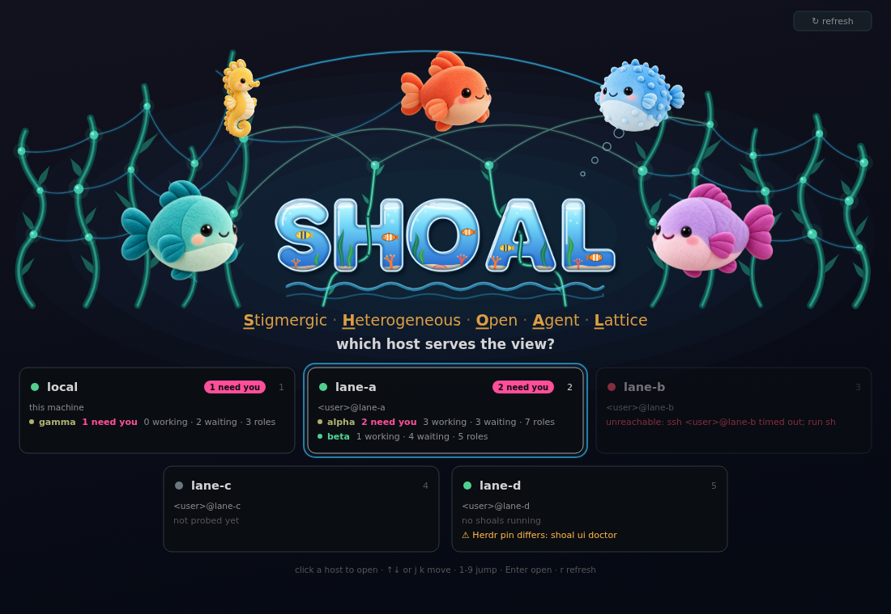

# Shoal home

The shoal splash screen and host chooser, drawn natively: the SHOAL logo with five plush sea
creatures around it (three fish, a seahorse and a blowfish), and one card per host that can serve
the shoal view, `local` first. Each card says whether the host is reachable, which shoals run
there, how many roles need you, and whether its Herdr pin is right. Click a card to open that
host's shoal spaces in the app.

(`preview.png` is a harness render of the bundled fixture, `preview/render_home.mjs`, not an app screenshot: the
geometry and colors are the mod's own, the text uses the render host's fonts.)

## What you see

- **Background:** the lattice view's canvas: a near-black violet to navy gradient (`#14111a` to
  `#03050b`, 165 degrees) with a navy wash (35 degrees), and a soft static bloom behind the logo
  (six stacked ellipses, blue then cyan, 2.2 percent alpha each).
- **Top right:** a `↻ refresh` button (96 by 24, steel `#1c2a30` at half alpha).
- **Logo** (`logo.js`, `glyphs.js`, `assets/logo.png`): `SHOAL` in bold, clean, rounded capitals made of glass, each
  a small aquarium, original geometry and no font. All five stand on one baseline, and nothing hangs below it. The cap
  height is 0.86 em and the em is 84 px times the scale, or less when the word would pass the logo box (3.9 em by 1.25
  em). It is drawn as a pre-rendered transparent PNG with `image()`, at `logoImageBox`, exactly on the vector letters.
  In the image, back to front: a soft blurred shadow, a dark rim, then in each letter pale air above a bright waterline
  (a slight wave), water in a gradient from light blue `#b4f7ff` to blue `#1f62cf`, top to bottom, and a small reef:
  a sandy floor, orange and red branching coral, green kelp, shells, a striped fish and a few bubbles, all kept to the
  lower part of the strokes so that most of each letter is open water. Over that, the glass: a darker inner edge, a
  highlight along the rim, a few specular streaks and a pale `#dff9ff` rim.
- **Fallback logo:** until the assets are known to be there (the first render), or when one is missing, the logo is
  two paths: the plain outlines in the same gradient, and the pale rim (about 230 commands).
- **The sea** (`ocean.js`, a pure display list): kelp strands rise from a seabed line just above the
  tagline, only in the room either side of the logo (a strand's sway is clamped to its side). The two sets are
  the two shoals. Each strand is a dark `#0d4f4c` body, a `#1f8f7a` middle and a light `#5fd3b0` midrib, with three
  leaf blades and two or three floats (`#47d6b4`, a glow ring and a highlight). The floats are a network: tendrils
  (`#38c8ff`, a 7 percent halo under a 42 percent line) link same-height floats of neighbouring strands and link each
  creature's rim to its nearest float; a tendril that would cross the logo is dropped.
- **Solo vines** (`SOLO_VINES` in `ocean.js`): between the two sets, two slimmer vines are the standalone sessions.
  Each rises from the seabed, threads a letter and ends on one float above the logo, either side of the coral. The
  first comes up from below the S and H gap, under the H's left stem, over its bar and out through its open top; the second from
  below the A and L gap, under the A's right leg, over its bar, under its left stroke and out over the O and A gap. All of
  a vine is painted behind the logo, then its over-crossings are painted again after the letters (`front`), each
  crossing starting and ending in open water, so no seam shows. Waypoints are in the letter's own cap units
  (`logo.js` `capPoint`), so the weave holds at any scale.
- **Links between the shoals:** each solo float is tied to both sets by a mint `#8af0c8` tendril (four links), and
  one stronger blue tendril is the only direct link between the sets. All five arc over the logo from floats of the
  strands nearest it, each its own float, and each is checked point by point to stay off the letters. Below the logo,
  two foam waves; above its right end, four rising bubbles. Items of one style are merged into one path (about 45 to
  55 layers behind the logo and 6 in front of it).
- **Path budget:** every path command is a native call, and a render has the mod engine's time limit. The heaviest
  render is the one before the asset check, at most about 1310 commands (the largest window: sea 1031, vines in front
  12, fallback logo about 230, background and bloom 34), and a test fails above 1350. Once the image is known, the logo
  costs no path at all.
- **Creatures** (`assets/fish-*.png`, 384 px RGBA), placed like the terminal splash: coral
  centered above the logo, the seahorse above left, the blowfish above right, teal left of the
  logo, violet right of it. Size in units of B = 92 px times the scale: coral 1.1, seahorse 0.85,
  blowfish 0.95, teal and violet 1.35.
- **Tagline** at 15.5 px times the scale (14 px on the text screen) in amber `#ffb547` at 86 percent:
  `Stigmergic · Heterogeneous · Open · Agent · Lattice`, each initial semibold in full amber with a wavy
  underline (the acronym), separators at 45 percent; then `which host serves the view?` in ink
  `#d4d4d4`, semibold.
- **Host cards** (248 to 340 px wide, up to four per row, rows balanced and centered, radius 10,
  `#0b0e12` at 92 percent, steel border): header with the reachable dot (green `#50d090`, red
  `#ff4d5e` for unreachable, grey `#6b7780` for not probed yet), the host name (14.5 px semibold),
  a `last` chip, a `N need you` pill in the theme's `blocked` color, and the host's digit key.
  Lines below, 18 px each: the route (`this machine` for local) in Geist Mono; one row per shoal
  (up to four, then `+n more shoals`): a tint dot, the tag in its pastel, `N need you` in the
  blocked color, then `W working · Q waiting · R roles`; `⚠ Herdr pin differs: shoal ui doctor`
  in amber when `pin_ok` is false; and the open status.
- **Last choice:** a cyan ring 5 px outside the card. **Keyboard selection:** a brighter border.
- **Footer:** `click a host to open · ↑↓ or j k move · 1-9 jump · Enter open · r refresh`.
- **Text screen:** below 640 by 460, when the art does not fit, with `art: false`, or when an
  asset file is missing: the same logo (48 px, 34 px under 420 wide), tagline and cards, no
  creatures, scrolling when the cards need it.

## How it behaves

- Reads the host list once at start, every 20 s (`poll_ms`), and on `↻` or `r`. A poll that
  changes nothing does not redraw. A failed refresh keeps the last good list and says so in the
  footer.
- **Clicking a card** (or Enter on the selected one) runs `shoal ui app-open --machine <name>`
  here. The card shows `opening…`, then `✓` and the command's summary (a JSON `summary`,
  `message` or `error` field, else its last stdout line), or `✕ exit N:` and the error's last
  line in red. Success rereads the list, so the ring follows the new last choice. One open at a
  time. With the fixture source a click only says what it would run.
- **Unreachable cards** are at half opacity and do not click; the dot and card carry the doctor
  hint as a tooltip. A not-probed card (`reachable: null`) can be clicked.
- **Keys** (the mod is focusable): arrows or `j`/`k` move (wrapping), a digit selects that host,
  Enter opens, `r` refreshes. The mouse is primary.
- **Motion:** only at the `full` tier (lattice-view's budget, `auto` by default: full on a GPU
  renderer with the window focused), each creature drifts 10 px times the scale up and down with
  a native `.loop("top")`, periods 4.7 to 6.4 s, and the kelp and the solo vines sway a few pixels with a native
  `.loop("left")` (a vine's two copies with the same amplitude and period, so the weave holds). The logo never
  moves. Every other tier is still. All loops stop for good once a host has been opened, because any native
  animation redraws the whole window.

## Built from

- A pane mod (`mod.json`: `place: "none"`, `focusable: true`), opened as a tab:
  `tab.new {name: "home", mod: "shoal-home", props}`.
- Props: `source` (`{kind: "exec", argv, on}`, default argv
  `["shoal","ui","launch","--list","--json","--summary"]` here, or `{kind: "fixture", path?}`),
  `motion`, `renderer`, `art`, `poll_ms`.
- `main.js` (the View), `model.js` (list parsing, card lines, keys, open results), `layout.js`
  (composition per window size), `ocean.js` (the sea), `logo.js` and `glyphs.js` (the logo), `motion.js` (a verbatim
  copy of lattice-view's). The sea and the logo are pure, so `main.js` keeps the last result per layout (`lastResult`).
- `assets/logo.png` is generated. The letters are built in `glyphs.js` (rounded polygons, ovals, and for the S a stroke
  along two ovals). The reef is `preview/logo_reef.mjs`, drawn procedurally and seeded, in each letter's cap units. To
  change either, run `preview/gen_logo_image.mjs` (a CPU-only headless browser, 244 px to the em, which is twice the
  largest logo). Tests fail when the PNG's size is not the frame `logo.js` places, when its pixels do not land on the
  vector letters, when anything solid hangs below the baseline, or when open water is under 72 percent of a letter's
  inside: the reef stays modest, and the letters stay legible.
- Herdr: `exec` (the list and `ui app-open`), `readTextFile` (the fixture; `/proc/self/environ`
  and `/proc/self/maps` once for the renderer probe), `fs/promises` `exists` (the assets), `theme()`,
  `nextCommand` (`focus`, `refresh`, `open`), `window()`.
- GPUI: `image()` for the creatures and the logo, `window.paint_path` for the background, the bloom, the sea and the
  fallback logo, absolute divs for everything else, `on_size_change` on the root.

## Watch out

- **Copy the folder, do not symlink it.** In Herdr app 0.1.12 `image()` does not load a PNG
  from a mod folder that is a symlink pointing outside the app home ("Embedded resource not
  found"), though `svg()` does. The existence check passes through the link, so the layout keeps
  room for creatures that never draw.
- Card heights are computed from the line count (`layout.cardHeight`), so every line must stay
  exactly 18 px (`.h(CARD.line)`), or the cards clip.
- Outlines in `glyphs.js` never touch, and a counter winds against its letter, so either fill rule fills them the
  same. Keep it so when changing the letters: a test checks every edge pair.
- **Do not draw the glass or the reef on a render.** They are far too many path commands. An earlier logo of about 3500
  had `herdr-app check` interrupted in `render` in most runs, and the app showed "This view could not be re-rendered".
  The limit is sharp and on wall-clock time: with `check` at the default window, about 2800 commands never failed in 24 runs, 3500
  failed twice and 4150 every time, and a starved CPU trips it at any count, this mod's old versions included. One passing
  check proves little here: run it a dozen times after adding to what a render draws, against a known-good version in
  the same loop.
- `herdr-app check` reaches the render with the assets already checked, so it never exercises the fallback logo. The
  fallback is held by the tests and by `render_home.mjs --first-render`.
- The list contract is additive: unknown fields are ignored, a repeated host name keeps its first
  row, a `last` naming no host is dropped.

## Done when

- `herdr-app check` passes on the copied folder.
- With `{"source":{"kind":"fixture"}}`: five creatures around the logo at a full-size window, five
  cards (`local` first), `lane-a` ringed and selected, `lane-b` greyed with its hint as a tooltip,
  `lane-c` grey dot `not probed yet`, `lane-d` with the pin warning.
- With `art: false`: the text screen.
- `node --test tests/herdr_app/test_shoal_home.mjs` passes.
- `node plugins/shoal-herdr-app/preview/render_home.mjs --out /tmp/home.svg` draws the same geometry for review where
  the app cannot run (`--first-render` with the fallback logo).
