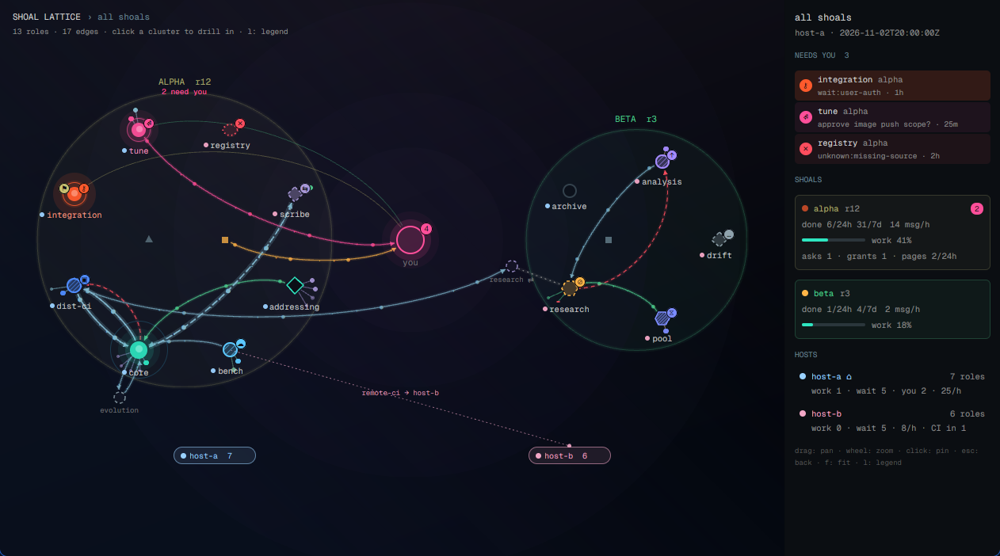

# Shoal lattice

A dark, glowing network of every shoal (a group of coding-agent roles coordinating through a git
ledger): each shoal a cluster of role nodes around the operator ("you") hub, edges for messages,
asks, offers, grants and blockers with dots marching along the busy ones, and every role that
waits on you pulsing loud enough to see from across the room. A rail on the right lists who needs
you, per-shoal throughput and per-host load.

## What you see

- **Canvas** (left, fills the pane): a near-black violet to navy gradient (`#14111a` to
  `#03050b`, 165 degrees) with a cool navy wash and a soft bloom behind the hub. Header top left in
  Geist Mono 11px: `SHOAL LATTICE > all shoals`, counts below in `#8c8c8c` 9.5px.
- **Global view:** shoals on a ring around the `you` hub (22px ring, magenta `#ff4f9a` with a count
  badge when asks or grants are open). Each shoal is a translucent disc in a pastel tint (olive
  `#b0b070`, mint `#50d090`, teal `#70b090`, ...), its name and generation above, `N need you` in
  magenta. Roles sit on a ring inside; the shoal writer (small square) and wake relay (small
  triangle) inside that. External writers (dashed circles) sit outside, an aliased one beside its
  home role. Physical servers are pills along the bottom (`host-a 7`), each in its host color.
- **Per-shoal view:** the shoal's roles on one ring split into host sectors: translucent annular
  bands in the host color, labeled with the host name (`⌂` marks the shoal's home). The hub in the
  middle, writer and relay inside, externals outside.
- **Nodes:** shape by ecosystem (circle claude, hexagon codex, diamond opencode), size by work done
  in 24 h, a host-colored dot before each label, a state badge top right, an olive `⚑` grant badge
  top left. State encodings:

  | state | look |
  |---|---|
  | working | teal `#2ee6c0` body, slow breathing halo |
  | user-auth | hot orange-red `#ff5a2c`, fastest pulse and ring, `⚷` badge |
  | user-ask / user-prompt | magenta, fast ring, `?` / `⏎` |
  | user-design | magenta, `✎` |
  | assignment / sources | softer magenta `#d985b6`, slow halo, `∅` / `↧` |
  | local-ci | blue `#4e8cff`, hatched at 4px, spinner arc, `▣` |
  | remote-ci | sky `#5cc8ff`, hatched at 7px, spinner arc, `☁` |
  | lease | periwinkle `#7c8cff`, dense hatch, `⧖` |
  | upstream | violet `#a58bff`, hatched, `↑` |
  | session-blocked (peer) | amber `#ffb547` dashed outline, `⊘`, a red dashed `blocked-on` edge to the blocker |
  | self | teal outline, no fill |
  | handover / refill / hold | lavender `⇆` / mint `↺` / grey `∥` |
  | any other wait event | grey dashed, `…`, raw event in the card |
  | idle | dim slate; excluded: hollow ring at 42 percent |
  | unknown or dead | red dotted outline, `✕` |

- **Edges:** curved beziers (a to b and b to a bow apart), each a wide low-alpha glow under a thin
  core, arrowheads at the target. Colors: msg steel cyan, ask magenta, offer mint, grant olive,
  health amber, handoff lavender, blocked-on red dashed, alias grey dotted. Opacity and width by
  recency (hot within the 5 min window, warm within the hour, cold). Cross-host traffic has a long
  subtle dash. A role whose CI job runs on another host has a dotted tether to that host's region
  or pill, labeled `remote-ci -> host-b`.
- **Satellites:** each role's active item, next items and items done in 24 h as small dots on
  short spokes fanned outward: the starburst.
- **Rail** (272px, `#0b0e12`): the view name and feed time; NEEDS YOU rows (badge, role, shoal,
  ask text, age), loudest first; SHOALS cards (urgent-state dot, needs-you pill, done 24h/7d,
  msg/h, work share bar, sparkline, asks, grants, pages); HOSTS (roles, working, waiting, msg/h,
  CI jobs placed in).

## How it behaves

- Polls the graph doc every 4 s (`exec` of `shoal ui graph --json`, then `--since <cursor>`), or a
  file, or the bundled fixture. A failed read keeps the last good picture with a red note.
- Motion is native and runs only while drawn: halos and rings `loop` opacity; marching dots are
  `frames` glyph lists rotated per dot so the bright head moves source to target, faster with
  `rate_per_h`; a broadcast ripples out of its sender (`loop` on left, top, width, height,
  opacity); each new event (by `seq`) sends one packet along its edge (`transition` on left/top),
  a `done` flashes a mint ring.
- Hover a node: everything not connected fades, a card shows its state and age, ecosystem, model,
  host, CI job host, grants, done and messages, context size, asks, items with blockers (stale in
  red) and the `shoal view` command. Click pins the card; item lines become links; the command
  copies. Drag pans, wheel zooms at the pointer, click a cluster drills in, Escape backs out, `l`
  toggles a legend of every encoding, `f` fits.
- Pulse mode: one row per shoal; clicking a row sets shared `shoal-lattice.focus` so a Lattice tab
  drills in with the loudest role pinned.

## Built from

- A pane mod, `mod.json` `{"place": "none", "focusable": true}`; no layout of its own. Pulse is the
  same mod as a floating `peek` block with `props.mode: "pulse"`.
- `main.js` (View): `cx.timer.every` for data only, `cx.spawn` + `exec` / `readTextFile`,
  `nextCommand`, `shared` / `setShared`, `placement`, `theme` (rail border), `appHome`.
- Pure modules (no Herdr imports, tested under Node): `model.js` (doc to view model, encodings,
  needs-you order, edge buckets, host palette, event diff), `layout.js` (targets plus a compact
  Fruchterman-Reingold refinement, seeded by a hash of each node id, warm-started), `geom.js`
  (curves, arrowheads, arc-length samples, hit tests, pan/zoom), `scene.js` (the display list).
- Drawing: one `relative()` canvas; every path layer is `window.paint_path(path, Background)`
  absolutely positioned over the whole canvas; edges batched one glow and one core path per
  color x tier bucket; hatch with `Background.pattern_slash`; dashes with `dash_array`. Nodes,
  halos, badges and labels are absolute divs. `arc.svg` is the spinner.
- Runs whatever `source.argv` says, on `source.on`; reads `source.path`; nothing else.

## Watch out

- `PathBuilder.cubic_bezier_to` takes the end point first, then both controls.
- One Background per path: batch by color, or the element count explodes. Paths are drawn in
  screen space, so pan and zoom re-render (cheap at this size).
- A `loop` or `frames` element wakes its whole view at about 30 fps natively (no script). Keep
  dots capped (240, or 80 with `motion: "low"`); `motion: "off"` removes all of it.
- `transition` animates a change between two renders, so a packet needs two: drawn at the source,
  then (a 60 ms `timer.after`) given the target. A pure timer animation would redraw everything.
- `on_size_change` arrives after the first layout: make the canvas `flex_1`, not a fixed width.
- The first doc read is a baseline; only later events animate.
- Glyph badges (`⚷ ☁ ⧖ ✎ ⏎ ⊘`) rely on font fallback beyond Geist Mono.
- Unknown wait events render as "other", unknown classes as "unknown"; never throw on new values.
- Feed details to honor: `blocked-on` and `alias` edges have null `last_ts`/`last_age_s`; a
  `stale` blocker draws fainter; the feed's `cross_host` wins over comparing hosts; `writer`
  nodes (unknown or removed writers) draw as small dashed nodes; a `state.source` of `posture`
  gets a `~` in the card; `state.job.host` counts as a job host; `hosts[]` counts win in the
  rail; a `cursor_reset` doc is a new event baseline.
- In Herdr app 0.1.12 an edit to a mod folder that is a symlink did not always refresh copies
  already open; reopening the tab picks up the new code. `herdr-app check` always reads it fresh.

## Done when

- `herdr-app check` passes and `herdr-app status` shows no errors.
- With the fixture: two clusters around `you`, `integration` pulsing orange-red with `⚷` and a
  `⚑`, `tune` magenta with `⏎`, `dist-ci` and `bench` hatched blue with different badges, a dotted
  tether from `bench` to the `host-b` pill, three rows under NEEDS YOU (integration, tune,
  registry), two host rows.
- Every 4 s a packet crosses one edge; dots march along hot edges; `core` ripples.
- Clicking the alpha disc drills in to host bands; Escape returns.
- `node tests/herdr_app/test_lattice.mjs` passes.
